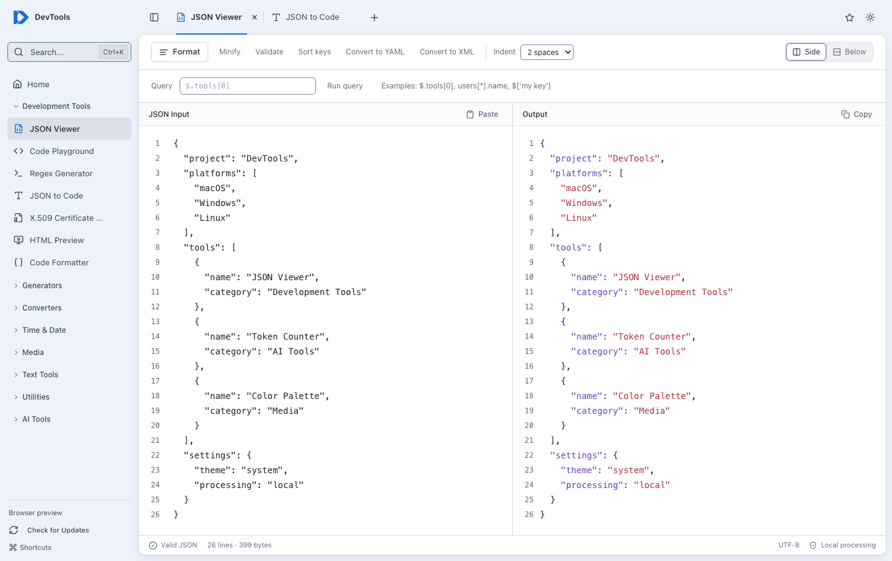

# DevTools Desktop

Offline-first developer utilities for macOS, Windows, and Linux. No cloud dependencies, no data collection.




## Features

### Development Tools

- **JSON Viewer** - Format, validate, minify, and sort JSON, run JSONPath queries, and convert to YAML or XML
- **Code Playground** - Multi-language editor (JS, HTML, CSS, JSON, Markdown)
- **Regex Generator** - Interactive regex construction with live testing
- **JSON to Code** - Generate TypeScript, Go, Rust, Python, Swift, and Kotlin types, or a JSON Schema, from JSON
- **X.509 Certificate Decoder** - Read PEM and DER certificates and CSRs, check validity and fingerprints, and verify a chain offline
- **HTML Preview** - Render HTML in a sandbox that cannot reach the network or the app
- **Code Formatter** - Beautify or minify HTML, CSS, JavaScript, XML, and SQL

### Generators

- **Hash Generator** - MD5, SHA-1, SHA-2, SHA-3, and Keccak-256 hashes, HMAC, and file hashing
- **UUID Generator** - Generate v1/v3/v4/v5/v6/v7 UUIDs and ULIDs, and inspect existing IDs
- **Password Generator** - Generate secure passwords and passphrases with strength analysis
- **Lorem Ipsum** - Generate placeholder text and fake names, emails, URLs, and titles as text or a JSON array
- **QR Generator** - Generate scannable QR codes and save them as PNG files
- **Bcrypt Generator** - Generate bcrypt hashes locally
- **Random String** - Generate Nano IDs, hex and Base64URL tokens, and strings from a custom alphabet

### Converters

- **Base64** - Encode and decode text, files, and data URIs, with a URL-safe mode
- **Case Converter** - Convert names to camelCase, snake_case, kebab-case, and 8 more cases live, one name per line
- **Number Base** - Convert between decimal, binary, octal, and hex, including very large numbers
- **Markdown** - Live, sanitized preview and HTML export
- **URL Encoder** - Encode and decode URLs, and parse a URL into editable parts and query parameters
- **CSV to JSON** - Bidirectional CSV and JSON conversion with custom delimiters
- **YAML to JSON** - Convert YAML to JSON and back, including multi-document YAML
- **Escape Tools** - Escape and unescape HTML entities, backslash strings, Unicode, and hex
- **HTML to JSX** - Convert HTML markup into React JSX
- **SVG to CSS** - Turn an SVG into a small data URI and ready CSS for backgrounds and masks
- **PHP Tools** - Convert serialize() data, session data, and PHP arrays to JSON and back, and repair broken string lengths
- **cURL to Code** - Convert a cURL command to fetch, Node, Python, Go, PHP, Rust, or HTTPie code

### Time & Date

- **Timestamp** - Unix timestamp conversion with multiple formats
- **Date Difference** - Calculate the difference between two dates
- **Cron Calculator** - Build cron expressions with plain English descriptions

### Media

- **Color Palette** - Convert HEX, RGB, HSL, and HSV, check WCAG contrast, and create color schemes
- **Image Converter & Compressor** - Convert a single image or batch-compress JPG, PNG, and WebP files locally
- **QR Reader** - Read a QR code from an image file, a dropped image, or a pasted screenshot

### Text Tools

- **Text Compare** - Line-by-line diff that can ignore whitespace and case
- **JWT Decoder** - Decode JWT tokens and verify HS256, HS384, and HS512 signatures
- **API Formatter** - Format REST and GraphQL responses with tree view and search
- **String Inspector** - Count characters, words, lines, and bytes, and find hidden Unicode characters
- **Line Tools** - Sort, reverse, dedupe, trim, and shuffle lines

### AI Tools

- **Image Metadata Cleaner** - Remove AI prompts, Content Credentials (C2PA), AI-generated labels, GPS, and camera data from JPEG, PNG, and WebP images. Keep the original pixels, or save a clean copy as JPG, PNG, WebP, or AVIF
- **Secret & PII Redactor** - Mask API keys, tokens, passwords, emails, and other personal data before you paste text into an AI chat, and restore the values in the reply
- **Token Counter** - Count GPT tokens exactly, estimate Claude, Gemini, and Llama tokens, check the context window, and estimate cost from your own price table
- **AI Text Cleaner** - Remove hidden characters, citation markers, and Markdown from AI-written text, and straighten quotes and dashes

### Utilities

- **Unit Converter** - Convert length, weight, temperature, and currency units

## Download

Get the latest release for your platform:

- **[macOS (Intel)](https://github.com/me-shaon/devtools/releases/latest/download/DevToolsApp-macos-x64.dmg)**
- **[macOS (Apple Silicon)](https://github.com/me-shaon/devtools/releases/latest/download/DevToolsApp-macos-arm64.dmg)**
- **[Windows](https://github.com/me-shaon/devtools/releases/latest/download/DevToolsApp-windows-setup.exe)**
- **[Linux — .deb (Debian, Ubuntu, Mint) (x64)](https://github.com/me-shaon/devtools/releases/latest/download/DevToolsApp-linux-amd64.deb)**
- **[Linux — .deb (Debian, Ubuntu, Mint) (arm64)](https://github.com/me-shaon/devtools/releases/latest/download/DevToolsApp-linux-arm64.deb)**
- **[Linux — .rpm (Fedora, RHEL, openSUSE) (x64)](https://github.com/me-shaon/devtools/releases/latest/download/DevToolsApp-linux-x86_64.rpm)**
- **[Linux — .rpm (Fedora, RHEL, openSUSE) (arm64)](https://github.com/me-shaon/devtools/releases/latest/download/DevToolsApp-linux-aarch64.rpm)**
- **[Linux — .AppImage (x64)](https://github.com/me-shaon/devtools/releases/latest/download/DevToolsApp-linux-x86_64.AppImage)**
- **[Linux — .AppImage (arm64)](https://github.com/me-shaon/devtools/releases/latest/download/DevToolsApp-linux-arm64.AppImage)**

### Upgrading from v1.3.0 or earlier

Version 1.3.0 and earlier used Electron. Later versions use Tauri. The Electron version updates to the Tauri version through its usual update button.

- On macOS, the app closes after the update. Open DevTools again to start the new version.
- On Windows, the new installer removes the Electron version.
- On Linux, the new `.deb` and `.rpm` packages replace the old `devtools` package. An AppImage is replaced in place.

Your favorites, recent tools, theme, and custom shortcuts do not move to the new version. Set them again after the update.

## Work Faster

- **Paste to find a tool.** Paste text outside a text field, and DevTools suggests the tool that fits: a JWT, JSON, a URL, a UUID, a timestamp, a cron expression, a certificate, a cURL command, and more. Press Enter to open the tool with the text filled in. DevTools only reads what you paste. It never reads the clipboard on its own.
- **Menu bar and tray.** The DevTools icon in the macOS menu bar, or the Windows and Linux tray, opens the app or its tool search.
- **Global shortcut.** Press Ctrl+Shift+Space in any app to open DevTools with its tool search. Press it again to hide DevTools. Change or turn off the shortcut in Shortcuts.

## Open a Tool from Other Apps

DevTools registers the `devtoolsapp://` link scheme, so Raycast, Alfred, Shortcuts, a terminal, or a browser can open a tool directly. A link reuses the running window.

| Link | Result |
|---|---|
| `devtoolsapp://open/<tool-id>` | Opens a tool, for example `devtoolsapp://open/json-viewer`. The tool IDs are in `src/app/toolRegistry.ts`. |
| `devtoolsapp://search?q=<text>` | Opens the command palette with the text. |
| `devtoolsapp://home` | Shows the home page. |

From a terminal on macOS, run `open "devtoolsapp://open/hash-generator"`. On Linux, run `xdg-open` with the same link. On Windows, run `start` with the link.

## Quick Start

```bash
# Clone and install
git clone https://github.com/me-shaon/devtools.git
cd devtools
npm install

# Run locally (development mode)
npm run dev

# Build for distribution
npm run build
```

## Requirements

- Node.js 22+
- npm
- Rust (stable). Install it with [rustup](https://rustup.rs).
- The Tauri system dependencies for your platform. Refer to the [Tauri prerequisites](https://v2.tauri.app/start/prerequisites/).

On Debian or Ubuntu, install the Linux dependencies with this command:

```bash
sudo apt-get install -y libwebkit2gtk-4.1-dev libayatana-appindicator3-dev librsvg2-dev \
  libxdo-dev libssl-dev patchelf file rpm
```

## Architecture

```
src/
├── components/
│   └── tools/       # Tool implementations (41 React components)
├── app/
│   └── DevToolsApp.tsx   # Main app with sidebar navigation
└── main.tsx         # React entry point

src/lib/
└── desktop.ts       # Bridge to the Tauri runtime (version, updates, file saving)

src-tauri/
├── src/main.rs      # Tauri app entry point and native commands
├── tauri.conf.json  # Window, bundle, and updater configuration
└── capabilities/    # Permissions for the app window
```

### Tech Stack

- **Tauri** 2 for the desktop runtime (system webview and a Rust backend)
- **React** 18+ with TypeScript
- **Vite** for fast builds and hot reload
- **Tailwind CSS** for styling
- **shadcn/ui** for UI components
- No analytics or telemetry

## Development

The installers go to `src-tauri/target/release/bundle/`. Each platform builds only its own installers. CI builds all platforms.

### End-to-End Test

The `e2e/smoke.mjs` script starts the built app with [tauri-driver](https://v2.tauri.app/develop/tests/webdriver/) and checks the main flows. It runs on Linux and in CI:

```bash
cargo install tauri-driver --locked
npm run build
xvfb-run node e2e/smoke.mjs
```

### Running in Development

```bash
npm run dev    # Starts the Vite dev server and the Tauri app
```

### Build Scripts

```bash
npm run dev              # Development mode with hot reload
npm run dev:web          # Run only the web UI in a browser
npm run build            # Build the app and the installers for the current platform
npm run test             # Run the test suite
npm run lint             # Run ESLint
npm run dist:mac         # Build macOS packages (.app, .dmg)
npm run dist:win         # Build the Windows installer (NSIS .exe)
npm run dist:linux       # Build Linux packages (.AppImage, .deb, .rpm)
npm run brand:build      # Rebuild logos, PNG exports, favicons, and desktop icons
```

## Adding a Tool

1. Create component in `src/components/tools/YourTool.tsx`
2. Add tool definition to `ALL_TOOLS` array in `src/app/toolRegistry.ts`
3. Register the lazy-loaded component in `TOOL_COMPONENTS` in `src/app/toolRegistry.ts`
4. Add tests if the new tool has non-trivial behavior
5. That's it! The tool will appear in the sidebar automatically

## Contributing

We welcome contributions! This project is continuously being improved by user feedback and contributions.

### Pull Requests

Pull requests welcome. For major changes, open an issue first to discuss the proposed changes.

### Development Setup

```bash
git clone https://github.com/me-shaon/devtools.git
cd devtools
npm install
npm run dev  # Run in development mode
```

## License

MIT

## Brand assets

The [brand asset guide](assets/brand/README.md) includes SVG and PNG logos, desktop icons, social artwork, colors, and usage rules. The approved brand name is **DevTools**.
