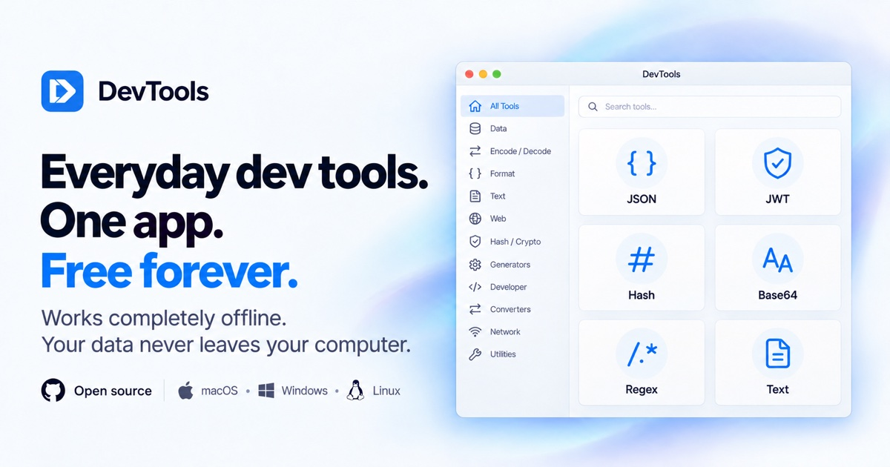
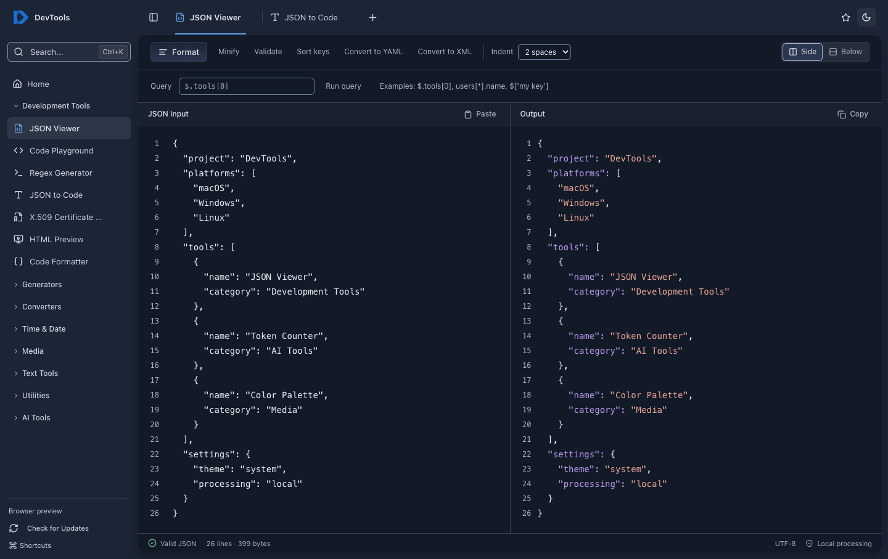

# DevTools

A desktop workspace with 56 developer utilities for macOS, Windows, and Linux. Format JSON, inspect tokens and certificates, convert data, generate code, and prepare text and images for AI workflows with local processing.



[Download](#download) · [Tools](#tools) · [Workspace and shortcuts](#workspace-and-shortcuts) · [Development](#development)


<details>
<summary>See dark mode</summary>



</details>

Screenshots show the current web UI in browser preview. The installed desktop app adds native window integration, tray access, global shortcuts, deep links, and automatic updates.

The utilities work offline without an account or an AI API key. DevTools includes no analytics or telemetry. The AI tools process your content locally; they do not call an AI service. App updates use the network.

## Download

Get the latest release for your platform:

- **[macOS (Intel)](https://github.com/me-shaon/devtools/releases/latest/download/DevToolsApp-macos-x64.dmg)**
- **[macOS (Apple Silicon)](https://github.com/me-shaon/devtools/releases/latest/download/DevToolsApp-macos-arm64.dmg)**
- **[Windows](https://github.com/me-shaon/devtools/releases/latest/download/DevToolsApp-windows-setup.exe)**
- **[Linux — .deb (Debian, Ubuntu, Mint) (x64)](https://github.com/me-shaon/devtools/releases/latest/download/DevToolsApp-linux-amd64.deb)**
- **[Linux — .deb (Debian, Ubuntu, Mint) (arm64)](https://github.com/me-shaon/devtools/releases/latest/download/DevToolsApp-linux-arm64.deb)**
- **[Linux — .rpm (Fedora, RHEL, openSUSE) (x64)](https://github.com/me-shaon/devtools/releases/latest/download/DevToolsApp-linux-x86_64.rpm)**
- **[Linux — .rpm (Fedora, RHEL, openSUSE) (arm64)](https://github.com/me-shaon/devtools/releases/latest/download/DevToolsApp-linux-aarch64.rpm)**
- **[Linux — .AppImage (x64)](https://github.com/me-shaon/devtools/releases/latest/download/DevToolsApp-linux-x86_64.AppImage)**
- **[Linux — .AppImage (arm64)](https://github.com/me-shaon/devtools/releases/latest/download/DevToolsApp-linux-arm64.AppImage)**

### Automatic updates

DevTools checks for updates on startup and every six hours, downloads new versions in the background, and installs them when you quit. Use **Restart now** to install a downloaded update immediately, or turn off **Update automatically** in the sidebar to manage updates yourself. Update checks and downloads require an internet connection.

### Upgrading from v1.3.0 or earlier

Version 1.3.0 and earlier used Electron. Later versions use Tauri. The Electron version updates to the Tauri version through its usual update button.

- On macOS, the app closes after the update. Open DevTools again to start the new version.
- On Windows, the new installer removes the Electron version.
- On Linux, the new `.deb` and `.rpm` packages replace the old `devtools` package. An AppImage is replaced in place.

Your favorites, recent tools, theme, and custom shortcuts do not move to the new version. Set them again after the update.

## Workspace and shortcuts

- **Keep tools open in tabs.** Switch between tools without losing their current inputs. Close a tab when you are finished.
- **Search by name or keyword.** Open the command palette with Cmd+K on macOS or Ctrl+K on Windows and Linux. Search for terms such as `sha`, `yml`, or `diff`.
- **Favorites and recents.** Pin up to five tools and return to recently used tools from Home. Cmd/Ctrl+1 through 5 opens your favorites. Customize these bindings in **Shortcuts**.
- **Light and dark appearance.** DevTools follows the system theme initially; use the appearance button to switch between light and dark.

- **Paste to find a tool.** Paste text outside a text field, and DevTools suggests the tool that fits: a JWT, JSON, a URL, a UUID, a timestamp, a cron expression, a certificate, a cURL command, and more. Press Enter to open the tool with the text filled in. DevTools only reads what you paste. It never reads the clipboard on its own.
- **Menu bar and tray.** The DevTools icon in the macOS menu bar, or the Windows and Linux tray, opens the app or its tool search.
- **Global shortcut.** Press Ctrl+Shift+Space in any app to open DevTools with its tool search. Press it again to hide DevTools. Change or turn off the shortcut in Shortcuts.

### Open a tool from other apps

DevTools registers the `devtoolsapp://` link scheme, so Raycast, Alfred, Shortcuts, a terminal, or a browser can open a tool directly. A link reuses the running window.

| Link | Result |
|---|---|
| `devtoolsapp://open/<tool-id>` | Opens a tool, for example `devtoolsapp://open/json-viewer`. The tool IDs are in [the tool registry](src/app/toolRegistry.ts). |
| `devtoolsapp://search?q=<text>` | Opens the command palette with the text. |
| `devtoolsapp://home` | Shows the home page. |

From a terminal on macOS, run `open "devtoolsapp://open/hash-generator"`. On Linux, run `xdg-open` with the same link. On Windows, run `start` with the link.

## Tools

### Development Tools

- **JSON Viewer** - Format, minify, sort, and query JSON live, convert it to YAML or XML, and repair JSON5, NDJSON, and Python, Ruby, or JavaScript literals
- **Code Playground** - Experiment with JavaScript, HTML, and CSS
- **Regex Tester** - Test a pattern as you type, with highlighted matches, capture groups, and live replace
- **JSON to Code** - Generate TypeScript, Go, Rust, Python, Swift, and Kotlin types, or a JSON Schema, from JSON
- **JSON Schema Validator** - Check JSON or YAML against a JSON Schema as you type, and click each error to find the failing value
- **JSON Diff** - Compare two JSON or YAML documents by value, list changes by path, match array items by key, and copy the changes as a JSON Patch
- **X.509 Certificate Decoder** - Read PEM and DER certificates and CSRs, check validity and fingerprints, and verify a chain offline
- **HTML Preview** - Render HTML in a sandbox that cannot reach the network or the app
- **Code Formatter** - Beautify or minify HTML, CSS, JavaScript, XML, and SQL
- **Semver Calculator** - Check versions against npm, Cargo, Composer, or Python ranges, see the range as plain comparators, and compare two versions
- **XML Inspector** - Format or minify XML, and query nodes or values with XPath 1.0 and namespace prefixes
- **ASN.1 Inspector** - Show definite-length DER or BER data from PEM, Base64, hex, or a file as a tree of tags, offsets, lengths, and values

### Generators

- **Hash Generator** - MD5, SHA-1, SHA-2, SHA-3, and Keccak-256 hashes, HMAC, and file hashing
- **UUID Generator** - Generate v1/v3/v4/v5/v6/v7 UUIDs and ULIDs, and inspect existing IDs
- **Password Generator** - Generate secure passwords and passphrases with strength analysis
- **Lorem Ipsum** - Generate placeholder text and fake names, emails, URLs, and titles as text or a JSON array
- **QR Generator** - Make QR codes for text, Wi-Fi, contacts, email, phone, SMS, locations and events, with an optional logo, and save them as PNG or SVG
- **Bcrypt Generator** - Generate bcrypt hashes locally
- **Random String** - Generate Nano IDs, hex and Base64URL tokens, and strings from a custom alphabet
- **Key Pair Generator** - Generate RSA, ECDSA, and Ed25519 key pairs as PEM, JWK, and OpenSSH keys with fingerprints, or convert a key you paste

### Converters

- **Base64** - Encode and decode Base64 and Base32 text, files, and data URIs, with a URL-safe mode
- **Case Converter** - Convert names to camelCase, snake_case, kebab-case, and 8 more cases live, one name per line, and make URL slugs
- **Number Base** - See a number in binary, octal, decimal, hex, any base to 36, and Roman numerals as you type, with two's complement views, integer expressions, and a clickable bit grid
- **Markdown** - Live, sanitized preview and HTML export
- **URL Encoder** - Encode and decode URLs, and parse a URL into editable parts and query parameters
- **CSV to JSON** - Bidirectional CSV and JSON conversion with custom delimiters and nested key flattening
- **Config Converter** - Convert between JSON, YAML, TOML, .env, Java .properties, and TOON files, including multi-document YAML, and see how many LLM tokens TOON saves against JSON
- **Escape Tools** - Escape and unescape HTML entities, backslash strings, Unicode, and hex, and convert domain names to and from Punycode
- **HTML to JSX** - Convert HTML markup into React JSX
- **SVG to CSS** - Turn an SVG into a small data URI and ready CSS for backgrounds and masks
- **PHP Tools** - Convert serialize() data, session data, and PHP arrays to JSON and back, and repair broken string lengths
- **Compression** - Decompress GZIP, zlib, and raw deflate from Base64, hex, or a .gz file, and compress text back, with format detection
- **cURL to Code** - Convert a cURL command to fetch, Node, Python, Go, PHP, Rust, or HTTPie code

### Network

- **IP / CIDR Calculator** - Get the network, broadcast, host range, masks, and address type for IPv4 and IPv6 blocks, and split, merge, or check ranges
- **HAR Viewer** - Filter, sort, and inspect the requests in a .har file from the browser, copy a request as cURL, and save a sanitized copy without credentials and cookies

### Time & Date

- **Timestamp** - Convert Unix timestamps (seconds to nanoseconds) and date strings as you type, with offsets such as now - 1d and extra time zones
- **Date Difference** - Calculate the difference between two dates
- **Cron Calculator** - Explain any cron expression in plain English, with a field breakdown and the next runs in your chosen time zone
- **Date Format Translator** - Translate date format strings between Go, strftime, Java, date-fns, Moment.js, PHP, and .NET, with a live preview
- **Stopwatch** - Record laps and split times, and copy or export them as CSV. The stopwatch keeps running while you use other tools

### Media

- **Color Palette** - Convert any CSS color to HEX, RGB, HSL, HWB, OKLCH, and HSV with alpha, check WCAG contrast, create color schemes, and simulate color blindness on colors and images
- **Image Converter** - Convert a single image or batch-compress JPG, PNG, and WebP files locally
- **QR Reader** - Read a QR code from an image file, a dropped image, or a pasted screenshot

### Text Tools

- **Text Compare** - Aligned line, word and character diff with change navigation that can ignore whitespace and case
- **JWT Decoder** - Decode JWTs with expiry status, verify HS, RS, PS, ES, and EdDSA signatures with a secret, PEM, JWK, or JWKS, and sign test tokens
- **API Formatter** - Format REST and GraphQL responses with tree view and search
- **String Inspector** - Count characters, words, lines, and bytes, find hidden Unicode characters, and check Unicode normalization (NFC, NFD, NFKC, NFKD)
- **Line Tools** - Filter, sort, reverse, dedupe, trim, and shuffle lines, and compare two lists

### AI Tools

- **Image Metadata Cleaner** - Remove AI prompts, Content Credentials (C2PA), AI-generated labels, GPS, and camera data from JPEG, PNG, and WebP images. Keep the original pixels, or save a clean copy as JPG, PNG, WebP, or AVIF
- **Video Metadata Cleaner** - Remove AI labels (C2PA, XMP), GPS, device data, dates, and telemetry tracks from MP4, MOV, MKV, and WebM videos without re-encoding. The audio and video data do not change
- **Secret & PII Redactor** - Mask API keys, tokens, passwords, emails, and other personal data before you paste text into an AI chat, and restore the values in the reply
- **Token Counter** - Count GPT tokens exactly, estimate Claude, Gemini, and Llama tokens, check the context window, and estimate cost from your own price table
- **AI Text Cleaner** - Remove hidden characters, citation markers, and Markdown from AI-written text, and straighten quotes and dashes

### Utilities

- **Unit Converter** - Convert length, weight, temperature, and data units
- **chmod Calculator** - Set file permissions with checkboxes, octal, or `rwx` text, apply expressions such as `u+x`, and see the chmod commands, a plain-English summary, and umask defaults
- **Checksum** - Calculate six common CRC variants from text, hex bytes, or a file, and validate or append Luhn check digits

## Development

### Prerequisites

- Node.js 22+ and npm.
- Stable Rust, installed with [rustup](https://rustup.rs).
- The [Tauri system prerequisites](https://v2.tauri.app/start/prerequisites/) for your platform.

On Debian or Ubuntu, install the native build dependencies:

```bash
sudo apt-get install -y libwebkit2gtk-4.1-dev libayatana-appindicator3-dev librsvg2-dev \
  libxdo-dev libssl-dev patchelf file rpm
```

### Run locally

```bash
git clone https://github.com/me-shaon/devtools.git
cd devtools
npm ci
npm run dev
```

For UI-only development, run `npm run dev:web` and open the URL printed by Vite. Browser preview does not provide native desktop integrations or the updater.

### Commands

| Command | Purpose |
|---|---|
| `npm run dev` | Start Vite and the Tauri desktop app with hot reload |
| `npm run dev:web` | Run the web UI in a browser |
| `npm run build:web` | Build the frontend into `dist/` |
| `npm run build` | Build the desktop app and installers for the current platform |
| `npm test` | Run the Vitest suite |
| `npm run test:watch` | Run tests in watch mode |
| `npm run lint` | Run ESLint |
| `npm run dist:mac` | Build macOS `.app` and `.dmg` packages |
| `npm run dist:win` | Build the Windows NSIS installer |
| `npm run dist:linux` | Build Linux AppImage, Debian, and RPM packages |
| `npm run brand:build` | Rebuild logos, favicons, and desktop icons |

Installers are written to `src-tauri/target/release/bundle/`. Each platform builds its own installers; CI builds the supported platforms. See the [release process](docs/release-process.md) for versioning, signing, and publishing.

### Desktop smoke test

The [smoke test](e2e/smoke.mjs) launches the built app through `tauri-driver` and checks the main flows on Linux. In addition to the build dependencies, install `xvfb` and `webkit2gtk-driver`:

```bash
sudo apt-get install -y xvfb webkit2gtk-driver
cargo install tauri-driver --locked
npm run build
xvfb-run node e2e/smoke.mjs
```

### Project structure

```text
src/
├── app/
│   ├── DevToolsApp.tsx     # Workspace, tabs, navigation, and app settings
│   └── toolRegistry.ts    # Tool names, categories, keywords, and lazy imports
├── components/
│   ├── app/               # Command palette, paste suggestions, and shortcuts
│   └── tools/             # Tool interfaces and shared workspace components
├── lib/desktop.ts         # Bridge to native desktop capabilities
├── utils/                 # Conversion, parsing, generation, and validation logic
└── main.tsx               # React entry point
src-tauri/                 # Rust backend, native integration, and bundle config
tests/                     # Unit and component tests
e2e/                       # Desktop smoke tests
scripts/                   # Release and brand asset tooling
```

Built with Tauri 2, React 18, TypeScript, Vite, Tailwind CSS, and shadcn/ui. Tauri uses the system webview with a Rust backend.

### Add a tool

1. Create the interface in `src/components/tools/YourTool.tsx` and put reusable logic in `src/utils/`.
2. Add its name, unique ID, category, icon, and search keywords to `ALL_TOOLS` in [toolRegistry.ts](src/app/toolRegistry.ts).
3. Register its lazy-loaded component in `TOOL_COMPONENTS` in the same file. The registry supplies sidebar navigation and tool search.
4. Add tests for non-trivial behavior, run the relevant checks, and update the tool list in this README.

## Contributing

Pull requests are welcome. For major changes, open an issue first to discuss the proposal. Include a description of the change and the checks you ran; include current screenshots for UI changes.

## Brand assets

The [brand asset guide](assets/brand/README.md) includes SVG and PNG logos, desktop icons, social artwork, colors, and usage rules. The approved brand name is **DevTools**.

## License

MIT
